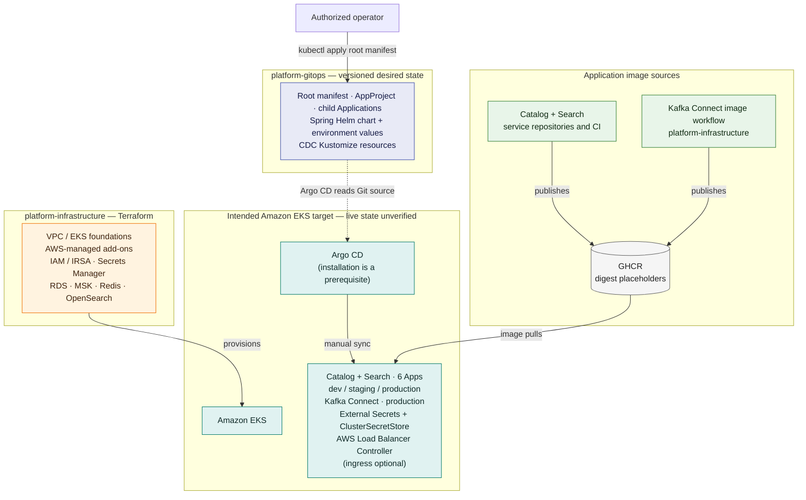

# platform-gitops

Declarative Kubernetes desired state for the `product-catalog` and
`product-search` services, Kafka Connect, and Kubernetes controllers/workloads
assigned to Argo CD. Terraform remains the owner of cloud infrastructure,
EKS foundations, and AWS-managed EKS add-ons; service repositories remain the
owners of application behavior and service container builds.

> **Deployment status:** This repository contains configuration, not proof of
> a deployed cluster. Argo CD Applications are intentionally manual-sync.
> Populate the documented cluster, secret-store, and immutable image inputs
> and obtain deployment approval before syncing.

## Architecture



Solid arrows show publishing, provisioning, bootstrap, or runtime flows;
dotted arrows show Git references, rendering, reconciliation, or external
configuration. Argo CD Applications are configured for manual sync. The EKS
target, Argo CD installation, AWS resources, and image availability have not
been verified as deployed; this diagram describes repository configuration
and intended relationships, not live status.
Runtime detail is collapsed for readability: External Secrets uses
Terraform-provisioned IRSA to read AWS Secrets Manager and materialize
referenced Kubernetes Secrets; workloads consume configured endpoints for
Terraform-managed data services.

## Ownership boundaries

| Owner | Responsibilities |
| --- | --- |
| Terraform / `platform-infrastructure` | VPC, EKS, IAM/IRSA, AWS-managed EKS add-ons, managed PostgreSQL, Kafka, Redis and OpenSearch, Secrets Manager resources, and infrastructure outputs |
| Service repositories | Application source, Dockerfiles, tests, APIs, migrations, event contracts, and service-specific behavior |
| `platform-gitops` | Argo CD projects/applications, Helm-installed Kubernetes controllers, workloads, services, probes, resource sizing, NetworkPolicies, environment configuration, and references to externally managed secrets |

Do not configure Terraform and Argo CD to manage the same Kubernetes resource.
The source manifests and Applications previously declared in
`platform-infrastructure` have been moved or consolidated into this repository.
That source change does not establish whether an older Argo CD root is active
in a cluster. Before syncing, inventory live Applications and resources from
an authorized operator context and deliberately transfer the root to this
repository; do not reconcile both roots against the same resources.

## Repository layout

```text
argocd/
  bootstrap/root-app.yaml       # Manually applied root Application
  projects/platform.yaml        # Restricted source/destination/resource boundary
  apps/                         # Child Applications
charts/spring-service/          # Reusable Helm chart for Spring Boot workloads
  templates/                    # Deployment, Service, secrets, scaling, policies, optional ingress
  values/
    product-catalog.yaml         # Service-specific settings
    product-search.yaml
    environments/                # Per-environment replicas, digests, secret IDs
kubernetes/platform/
  providers/aws/
    cluster-secret-store.yaml    # AWS-specific External Secrets configuration
  cdc/                           # Kafka Connect Deployment, service, policies, and secrets
scripts/                         # Production image pinning and optional ingress helper
.github/workflows/validate.yaml  # Helm lint and template validation
```

Helm is the primary service deployment format: one reusable chart renders
either service, and Argo CD combines the service values file with one
environment values file. Production values render autoscalers, disruption
budgets, and service-specific egress policies; ingress remains disabled until
the domain and certificate are configured. Kafka Connect uses a small
Kustomize base because it is a separate platform runtime, not a Spring
service. Upstream components are consumed as pinned Helm charts directly
through Argo CD.

The `platform` AppProject restricts repository sources and destination
namespaces. Its resource allowlists cover the External Secrets and AWS Load
Balancer controller integrations, cluster-scoped AWS ClusterSecretStore,
and the namespaced workload resources. Review rendered chart resources before
tightening or expanding those lists.

## Cross-repository ownership and migration

The Kubernetes manifests and Argo CD Applications are now declared here.
Terraform remains the source for AWS resources, IAM roles, and non-secret
infrastructure outputs. The infrastructure configuration helper writes
reviewed role ARNs, region, and Secrets Manager identifiers into this
repository's placeholders; it does not transfer or reveal secret values.

The AWS Load Balancer Controller and CDC Applications are defined here.
The controller is manually synced and requires the Terraform-created IAM role.
CDC is a separate manually synced Kustomize application; wait until the
catalog migration has created `public.outbox`, RDS logical replication is
active, and the CDC database credential exists before syncing it and
registering the connector.

The source move does not prove that the old infrastructure root is inactive.
Before applying the GitOps root in an existing cluster, inspect actual
Applications and resource ownership, then switch the existing `platform-root`
source deliberately. Do not apply both roots or assume that merging these
files performs a safe live handoff.

## Prerequisites

- An EKS cluster and foundational cloud resources provisioned by Terraform.
- A reachable Kubernetes API for the operator performing bootstrap and sync.
- Argo CD installed in `argocd`, configured to read this repository.
- A reviewed change to `argocd/bootstrap/root-app.yaml` if the repository URL
  or target branch differs from the defaults.
- Terraform-provided AWS identity/IRSA for External Secrets Operator and a
  provisioned Secrets Manager store with the expected per-environment values.
  The AWS-specific store definition is isolated under
  `kubernetes/platform/providers/aws/`.
- A GitHub Container Registry pull path available to cluster nodes.
- Published service image digests, recorded in the corresponding environment
  values file before syncing any service Application.
- A published Kafka Connect image digest before syncing the CDC Application.

No cluster, AWS account, endpoint, CRD, secret, domain, or image digest is
assumed to exist. The checked-in `REPLACE_ME` values are intentionally
non-operational placeholders, not deployable defaults. Never replace secret
references with secret values.

## Bootstrap and deployment

1. Review the Terraform and infrastructure deployment runbooks. Provision
   infrastructure separately; do not apply Terraform from this repository.
2. Confirm cluster access and identify existing Argo CD Applications and
   resource owners. If `platform-infrastructure` already manages these
   workloads, agree on a migration before proceeding.
3. Configure the External Secrets chart's AWS service-account role annotation
   and `ClusterSecretStore` region from reviewed Terraform outputs. From the
   infrastructure repository, run
   `scripts/configure-argocd-from-terraform.py --gitops-repo <path-to-this-repo>`
   after outputs and application secret values are ready. Review and commit the
   generated non-secret settings; never put secret values in Git.
4. Obtain reviewed immutable catalog, search, and (for production) Kafka
   Connect image digests. From this repository, update the environment's
   service values; production also updates the CDC Kustomize image pin:

   ```sh
   python3 scripts/set-image-digests.py \
     --environment production \
     --catalog-digest sha256:CATALOG_DIGEST \
     --search-digest sha256:SEARCH_DIGEST \
     --connect-digest sha256:KAFKA_CONNECT_DIGEST
   ```

   Use `--environment dev` or `--environment staging` to pin the two service
   images in those environments; omit `--connect-digest` there.
   The all-zero pins intentionally fail closed. Promote the same tested
   digests between environments rather than promoting `latest`.
   Before a production sync, run
   `python3 scripts/validate-production-config.py` to check that AWS
   placeholders and zero image digests have been replaced.
5. Review and merge those Git changes. Apply only the root Application:

   ```sh
   kubectl apply -f argocd/bootstrap/root-app.yaml
   ```

6. Manually sync `platform-root` in Argo CD to create the AppProject and child
   Applications. Sync the External Secrets Operator Application first. Verify
   its deployment and CRDs are healthy; then sync `platform-cluster-config`
   and confirm the ClusterSecretStore reports `Ready`.
7. Sync one environment's service Application only after its secret
   references and images are ready. Verify Argo CD health, rollout status,
   pod events, application readiness, and logs without printing secret data.
8. Sync the CDC Application only after its prerequisites are ready. Register
   the connector from a trusted host using the interim connector configuration
   and helper in `platform-infrastructure`. The product-catalog service owns
   the outbox schema and event semantics; move connector configuration to that
   service repository when it can publish and maintain the definition.

All child Applications are manual-sync. The root only creates/reconciles the
Argo CD Application and AppProject objects; syncing the root does not authorize
service deployment.

## Image promotion

Service CI publishes images to:

- `ghcr.io/jahrough/product-catalog`
- `ghcr.io/jahrough/product-search`
- `ghcr.io/jahrough/platform-infrastructure/kafka-connect`

Use immutable registry digests from successful builds and update the
production service pins with `scripts/set-image-digests.py`; CDC's pin is in
`kubernetes/platform/cdc/kustomization.yaml`. Promote the same tested digest
between environments rather than rebuilding. This repository does not
currently have a verified published digest; all-zero fail-closed pins must be
replaced before the corresponding Application is synced.

## Rollback

Revert the Git commit that changed the image digest or Kubernetes settings,
merge the revert, and manually sync the affected Application. Verify the
Deployment rollout and application health. Application data migrations and
managed-service recovery belong to the service/infrastructure owners; a
manifest rollback does not reverse database changes.

## Validation

Install the Helm CLI and render each service with its environment values:

```sh
for environment in dev staging production; do
  for service in product-catalog product-search; do
    helm template "$service" charts/spring-service \
      --namespace "platform-${environment}" \
      --values "charts/spring-service/values/${service}.yaml" \
      --values "charts/spring-service/values/environments/${environment}.yaml" \
      >/dev/null
  done
done
```

The GitHub Actions workflow runs `helm lint`, all six service/environment
renders, validates production policy resources, renders the CDC Kustomize
configuration, parses rendered YAML, and tests the helper scripts. This checks
chart structure and template output; it does not prove live API compatibility,
CRDs, cloud values, image availability, Argo CD sync status, or workload
health.

## Optional ingress

The ALB controller Application must be configured from Terraform outputs and
synced before enabling ingress. For a domain controlled by you and a matching
regional ACM certificate, run:

```sh
python3 scripts/enable-ingress.py \
  --domain example.com \
  --certificate-arn arn:aws:acm:us-east-1:123456789012:certificate/00000000-0000-0000-0000-000000000000 \
  --region us-east-1 \
  --scheme internal
```

This enables ingress in production values only. `internet-facing` exposes
services publicly; the product APIs' authentication requirements must be
reviewed before choosing it. Review and commit the GitOps change, sync the
Applications only after approval, then create DNS records after the load
balancer is provisioned.

## Local development, monitoring, and exposure

Run local application development from the service repositories or the
infrastructure repository's Compose setup. No Kubernetes cluster or paid
cloud resources are required for that workflow.

The applications expose Spring Actuator health endpoints used for probes.
Prometheus/Grafana and an OpenTelemetry Collector/backend are not deployed by
this repository because no scrape/retention backend or tracing destination has
been verified. Do not enable external ingress until a controller, DNS/TLS
ownership, and application authentication requirements have been addressed.
In particular, the product-search API is currently documented as
unauthenticated.

## Teardown boundaries

Deleting an Argo CD Application with resource pruning can delete the
Kubernetes objects it manages. Review the Application's resources and
ownership before deleting or disabling it. Do not delete Terraform-owned
cloud infrastructure, managed data, Secrets Manager entries, or EKS resources
as part of a GitOps teardown. Preserve production data and recovery controls.

## Known blockers and assumptions

- The source move does not establish the live Argo CD root or workload
  ownership; inspect the cluster before changing the root source.
- The adjacent service build workflows publish tags, but no current image
  digest has been verified here. The configured all-zero image digests
  intentionally prevent a successful pull until reviewed.
- AWS role ARN, Secrets Manager region/keys, actual service endpoints, and
  cluster readiness have not been verified.
- The service repository metadata disagrees on Java versions for catalog and
  search; resolving that is out of this repository's ownership and approved
  scope.
